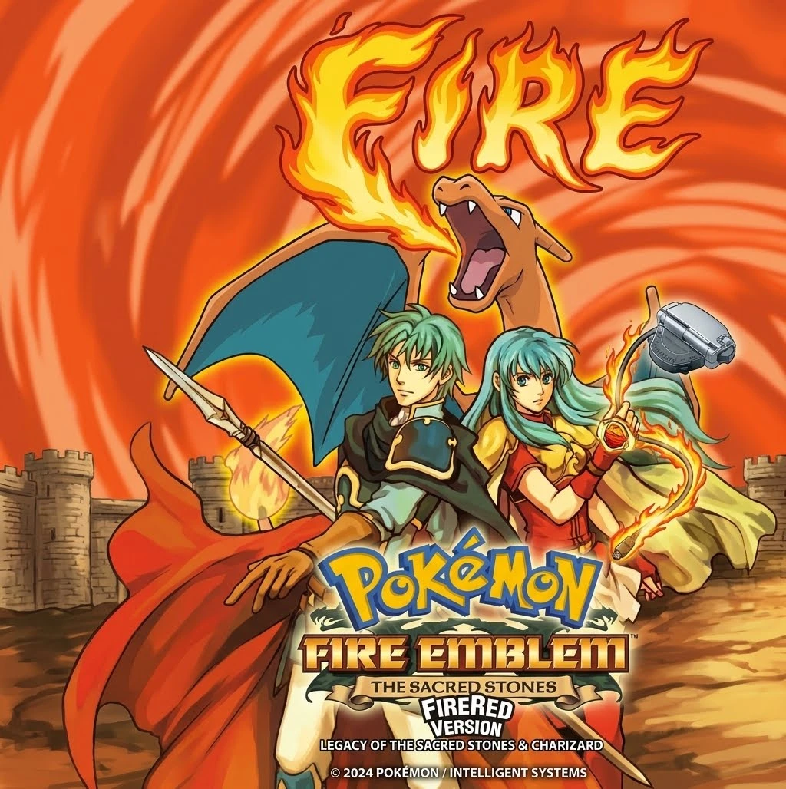

# PoekEmblem

## Play the release

Final files: `release/PokemblemTheSacredStones.gba` (ready to play) and `patches/PokemblemTheSacredStones.ips` (one patch, all changes).
To build the ROM yourself, apply the IPS to a clean Pokemon FireRed (USA) ROM, SHA-1 `41cb23d8dccc8ebd7c649cd8fbb58eeace6e2fdc`, with any IPS patcher (Lunar IPS, Floating IPS, MultiPatch), or run:

    python3 tools/apply_ips.py apply "Pokemon - FireRed Version (USA).gba" patches/PokemblemTheSacredStones.ips PokemblemTheSacredStones.gba

The result must have SHA-1 `7adcc1dd4a928d17b18eed1ae6271ed6300e5eac`. Never patch over your only copy of a ROM.

## Update: Eirika overworld sprite (Leg16)
The player's walking and running overworld sprite is now Eirika (blue hair, gold armor, red tunic, white skirt, red boots) instead of Leaf's. `patches/PokemblemTheSacredStones.ips` and `release/PokemblemTheSacredStones.gba` include it (SHA-1 of the ROM: `b788d9d7eee69038f6726d0dd6f37d8ab834b701`). The earlier release is kept in `patches/archive/` and `release/archive/`.
